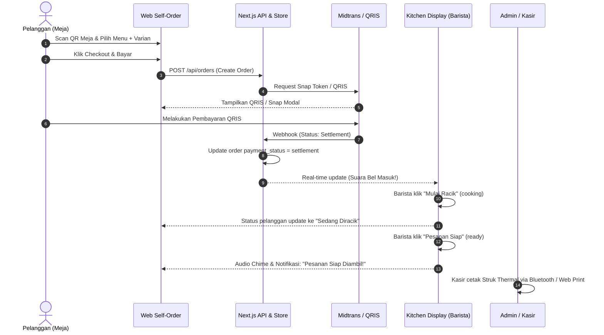

# 📋 Product Requirement Document (PRD)

## Sistem Self-Order & Kitchen Display System (KDS) Katalog Kopi & Snack

| Informasi Dokumen | Keterangan |
| :--- | :--- |
| **Nama Produk** | Katalog Kopi & Snack - Self-Order & POS System |
| **Versi Dokumen** | 1.0.0 |
| **Status** | Approved & Production-Ready |
| **Target Pengguna** | Pelanggan Resto/Kafe, Barista & Dapur, Kasir & Store Manager |
| **Tech Stack Utama** | Next.js 15, React 19, TypeScript, Tailwind CSS, Firebase, Midtrans |

---

## 1. Executive Summary & Problem Statement

### 1.1 Latar Belakang Masalah
Pada operasional kedai kopi (*coffee shop*) dan kafe konvensional, proses antrean di kasir seringkali menimbulkan hambatan (*bottleneck*), terutama pada jam sibuk (*rush hour*):
1. **Antrean Kasir yang Menumpuk**: Pelanggan butuh waktu lama untuk melihat buku menu fisik dan memutuskan pesanan di depan kasir.
2. **Human Error pada Modifikasi Pesanan**: Kustomisasi minuman (seperti tingkat gula, pilihan jenis susu, es batu, dan topping ekstra) sering keliru dicatat atau salah tersampaikan ke tim barista/dapur.
3. **Ketidaktahuan Status Pesanan**: Pelanggan kerap menanyakan status pesanan ke meja kasir karena tidak memiliki media pelacakan status pesanan secara *real-time*.
4. **Alur Dapur yang Tidak Terorganisir**: Tiket kertas mudah hilang atau tertukar urutan masaknya, mengakibatkan pesanan yang datang lebih dulu terlewatkan.

### 1.2 Solusi yang Diberikan
Sistem Self-Order & KDS ini menyediakan alur digital tanpa hambatan (*seamless digital flow*):
- Pelanggan duduk di meja, memindai QR Code unik meja, memilih menu dengan modifikasi visual yang jelas, dan membayar langsung via QRIS/E-Wallet.
- Dapur langsung menerima pesanan secara *real-time* di layar KDS disertai notifikasi suara bel.
- Pelanggan memantau tahapan peracikan minumannya dari layar *smartphone* masing-masing hingga siap diambil.
- Kasir/Admin memiliki akses rekap omset, status pesanan, dan kemampuan mencetak struk thermal secara nirkabel.

---

## 2. Tujuan Produk & Metrik Keberhasilan (OKRs)

| Metrik | Sasaran (Target) |
| :--- | :--- |
| **Waktu Tunggu Antrean Kasir** | Turun hingga 70% karena 60%+ pesanan dilakukan mandiri di meja. |
| **Akurasi Modifikasi Pesanan** | Mencapai 99.5% akurasi varian (susu oat, level gula, topping) tanpa salah catat. |
| **Kecepatan Konfirmasi Pembayaran** | Rata-rata < 3 detik dari scan QRIS hingga status pembayaran terverifikasi. |
| **Kitchen Order Turnaround Time** | Terpantau jelas dengan indikator SLA waktu tunggu pesanan (< 15 menit). |

---

## 3. User Personas & Use Cases

### Persona A: Rendy - Pelanggan (Customer / Diner)
- **Karakteristik**: Mahasiswa / pekerja WFC yang mengutamakan kecepatan dan kemudahan.
- **Kebutuhan**: Ingin langsung duduk, scan QR meja, memilih kopi susu dengan susu oat dan gula 50%, bayar via GoPay/ShopeePay, dan tahu kapan pesanannya selesai tanpa harus bolak-balik ke kasir.

### Persona B: Bayu - Barista / Tim Dapur (Kitchen Staff)
- **Karakteristik**: Bekerja cepat di stasiun peracikan kopi dan pemanggang snack dengan tangan sering basah atau sibuk.
- **Kebutuhan**: Layar interaktif responsif dengan kartu pesanan berukuran besar, label modifikasi mencolok, suara alert saat ada pesanan baru, dan tombol satu sentuhan untuk memindahkan status pesanan.

### Persona C: Citra - Store Manager / Kasir
- **Karakteristik**: Bertanggung jawab atas rekap keuangan harian, flow antrean toko, dan komplain pelanggan.
- **Kebutuhan**: Dashboard ringkasan omset harian, pencarian nota berdasarkan nomor pesanan/meja, cetak struk thermal 58mm/80mm ke printer kasir, dan master data meja.

---

## 4. Spesifikasi Fungsional (Functional Requirements)

### FR-1: Katalog Menu & QR Code Meja (`/table/[tableId]`)
- Sistem harus mengidentifikasi nomor meja dari parameter URL atau QR Code meja (misal: Meja 01, Meja 02, s/d Meja 12).
- Menampilkan kategori menu dinamis: *Espresso & Coffee*, *Manual & Cold Brew*, *Non-Coffee & Tea*, *Savory Snacks*, dan *Sweet & Pastries*.
- Menyediakan fitur pencarian nama menu secara *real-time* dan filter kategori.
- Menampilkan label khusus pada menu (misal: `Best Seller`, `Signature`, `Favorit`).

### FR-2: Mesin Kustomisasi Varian & Modifiers
- Setiap menu dapat memiliki 1 atau lebih grup modifikasi (*Modifier Groups*):
  - **Pilihan Suhu (Wajib / Single-choice)**: Dingin Segar (Iced) atau Hangat Nikmat (Hot).
  - **Pilihan Susu (Wajib / Single-choice)**: Fresh Milk (+0), Oatmilk (+Rp 6.000), Almond Milk (+Rp 7.000).
  - **Level Manis (Wajib / Single-choice)**: Normal (100%), Less Sugar (50%), No Sugar (0%).
  - **Extra Topping (Opsional / Multi-choice)**: Espresso Shot (+Rp 5.000), Coffee Jelly (+Rp 4.000), dsb.
  - **Kitchen Notes**: Kolom catatan tambahan bebas (misal: "jangan terlalu manis", "pisahkan saus").
- Sistem secara otomatis menghitung kalkulasi harga tambahan (*price modifier*) pada harga akhir item.

### FR-3: Keranjang Belanja (Cart Management)
- Menggunakan persistent store (Zustand) agar data keranjang tidak hilang saat halaman di-refresh.
- Item yang sama dengan varian berbeda disimpan sebagai baris belanja terpisah.
- Menampilkan ringkasan subtotal, total kuantitas item, serta input identitas pemesan (Nama & No. WhatsApp).

### FR-4: Integrasi Pembayaran Digital (Midtrans & QRIS Simulator)
- Terintegrasi dengan **Midtrans Snap API** untuk menerima pembayaran QRIS, Virtual Account, dan E-Wallet resmi.
- Menyediakan **Simulator QRIS Bawaan** untuk lingkungan pengembangan lokal:
  - Generate visual QRIS canvas.
  - Opsi auto-simulate bayar lunas dalam hitungan detik untuk keperluan testing dan demo.
- Endpoint Webhook Midtrans (`/api/midtrans/notification`) untuk menangkap notifikasi status transaksi (`settlement`, `expire`, `deny`, `cancel`) secara otomatis dan meng-update status pesanan.

### FR-5: Pelacakan Pesanan Pelanggan (`/orders/[orderId]`)
- Halaman status interaktif yang menampilkan *stepper timeline*:
  1. *Menunggu Pembayaran* / *Diterima*
  2. *Sedang Diracik & Dimasak*
  3. *Pesanan Siap Diambil / Diantar*
  4. *Selesai*
- Notifikasi audio otomatis saat status berubah menjadi "Ready".
- Tampilan nota digital lengkap dan tombol cetak struk web.

### FR-6: Kitchen Display System - KDS (`/admin/kitchen`)
- Real-time listening ke database Firestore untuk pesanan yang berstatus `payment_status: settlement`.
- Suara chime otomatis menggunakan synthesizer Web Audio API setiap ada pesanan baru yang masuk.
- Indikator SLA waktu tunggu (*elapsed time badge*):
  - Hijau: < 10 menit
  - Kuning: 10 - 15 menit
  - Merah berkedip (*warning*): > 15 menit
- Aksi satu klik: *Mulai Racik* (ubah ke `cooking`) dan *Pesanan Siap* (ubah ke `ready`).

### FR-7: Dashboard Admin & Cetak Struk Thermal (`/admin`)
- Ringkasan metriks harian: Total Omset (IDR), Total Transaksi Sukses, Jumlah Pesanan Aktif, dan Rata-rata Nilai Transaksi (AOV).
- Integrasi modul **ESC/POS Thermal Printer Driver** (`lib/thermal-printer.ts`):
  - Mendukung format lebar kertas 58mm (32 karakter/baris) dan 80mm (48 karakter/baris).
  - Cetak via Bluetooth Thermal Printer menggunakan Web Bluetooth API atau RawBT URI scheme.
  - Cetak via Browser Native Print dialog dengan layout nota kasir presisi.
- Kelola status pesanan secara manual jika dibutuhkan kasir.

### FR-8: Sinkronisasi Offline & Fallback Mock Store
- Jika kredensial Firebase belum di-set pada `.env.local`, sistem beralih otomatis ke **In-Memory Order Store** (`lib/order-store.ts`) tanpa membuat aplikasi *crash*.
- Endpoint seeder database (`/api/seed`) untuk mengisi data awal katalog menu dan meja secara otomatis dalam satu klik.

### FR-9: Pembayaran Tunai di Kasir (Cash at Cashier)
- Pelanggan dapat memilih opsi metode bayar tunai di modal checkout.
- Pesanan dibuat dengan status `payment_type: 'cash'` dan `payment_status: 'pending'`.
- Kasir di dashboard Admin dapat memvalidasi pelunasan uang tunai via tombol satu sentuh *"Konfirmasi Bayar Tunai (Lunas)"*, otomatis meneruskan pesanan ke antrean barista/dapur.

### FR-10: Manajemen Stok Cepat (Sold Out Toggle)
- Kasir/Owner dapat mengubah status ketersediaan menu secara langsung di tab *"Kelola Stok Menu"*.
- Menu yang berstatus habis (*sold out*) otomatis ditampilkan abu-abu dengan label *"Habis"* dan tombol pesan dinonaktifkan di layar smartphone pelanggan.

### FR-11: Pemisahan Stasiun KDS & Checklist Coret Item
- Kitchen Display System (KDS) menyediakan filter stasiun kerja:
  - ☕ **Stasiun Barista**: Khusus meracik pesanan minuman kopi & non-kopi.
  - 🍟 **Stasiun Dapur Snack**: Khusus memasak camilan dan makanan.
  - 📋 **Semua Stasiun**: Tampilan terpadu seluruh pesanan.
- Fitur checklist interaktif: Barista/koki dapat mengklik baris item untuk menandai item yang telah selesai diracik (tanda centang hijau dan efek coret).

### FR-12: Filter Tanggal Omset & Ekspor Laporan CSV
- Dashboard Admin POS menyediakan filter rentang waktu: *Semua Waktu*, *Hari Ini*, dan *Kemarin*.
- Tombol *"Download CSV"* untuk mengunduh rekap transaksi penjualan ke format spreadsheet.

---

## 5. Spesifikasi Data Model (Schema Types)

```typescript
// Status Meja
type TableStatus = 'available' | 'occupied' | 'reserved';

// Status Transaksi & Dapur
type PaymentStatus = 'pending' | 'settlement' | 'expire' | 'failed';
type OrderStatus = 'received' | 'cooking' | 'ready' | 'completed';

// Model Pesanan Utama
interface Order {
  id: string;                         // UUID / Firestore Doc ID
  order_number: string;               // e.g. "GC-260918-A101"
  customer_id?: string;               // e.g. "CUST-01-A89K"
  table_id: string;                   // e.g. "table-01"
  table_number: string;               // e.g. "01"
  customer_name?: string;             // e.g. "Rendy"
  customer_phone?: string;            // e.g. "08123456789"
  items: OrderItem[];                 // Daftar item yang dipesan
  total_amount: number;               // Total nilai pembayaran (IDR)
  payment_status: PaymentStatus;      // Status pembayaran
  order_status: OrderStatus;          // Status di dapur
  payment_type?: string;              // 'qris' | 'gopay' | 'shopeepay' | etc.
  snap_token?: string;                // Token transaksi Midtrans
  snap_redirect_url?: string;         // URL bayar Midtrans
  created_at: any;                    // Timestamp pembuatan
  updated_at: any;                    // Timestamp pembaruan
}

// Rincian Item Pesanan
interface OrderItem {
  menu_id: string;
  name: string;
  price: number;                      // Harga dasar + total modifier
  qty: number;
  selected_modifiers: SelectedModifier[];
  subtotal: number;
  notes?: string;
}
```

---

## 6. Persyaratan Non-Fungsional (Non-Functional Requirements)

1. **Responsivitas Perangkat (Mobile-First UI)**:
   - Tampilan pelanggan dioptimasi khusus untuk layar smartphone (360px - 430px) dengan *bottom navigation*, *swipeable drawers*, dan tombol aksi ramah jempol (*thumb-friendly*).
   - Tampilan KDS dan Admin dioptimasi untuk tablet (iPad/Android) dan monitor kasir desktop horizontal.
2. **Kinerja & Latensi**:
   - First Contentful Paint (FCP) < 1.2 detik.
   - Latensi pembaruan status pesanan antara pelanggan dan dapur < 1 detik dengan *Firestore Realtime Listener*.
3. **Keamanan & Validasi**:
   - Validasi signature key Midtrans SHA-512 pada webhook notifikasi untuk mencegah pemalsuan status bayar.
   - Sanitasi input pada kolom catatan dapur dan nama pelanggan untuk mencegah XSS.
4. **Keandalan Hardware Printer**:
   - Format teks nota ESC/POS menghasilkan baris rata kiri-kanan (*justified*) yang rapi pada kertas thermal 58mm standar kasir UMKM.

---

## 7. Alur Sistem (System Flow)



---

## 8. Roadmap Pengembangan Selanjutnya

- [x] **Fase 1 (MVP Selesai)**: Katalog Menu, Modifier Customization, Keranjang Zustand, QRIS Simulator, Midtrans Snap, Live Tracking, KDS Realtime, Struk Thermal ESC/POS.
- [ ] **Fase 2 (Manajemen Stok & Inventori)**: Notifikasi otomatis saat stok biji kopi atau cup habis, auto-disable menu jika bahan kosong.
- [ ] **Fase 3 (Multi-Outlet & Multi-Branch)**: Dukungan multi-cabang gerai dengan pemilihan lokasi outlet terdekat.
- [ ] **Fase 4 (Program Loyalitas / Membership)**: Akumulasi poin belanja pelanggan berbasis nomor telepon/WhatsApp.
